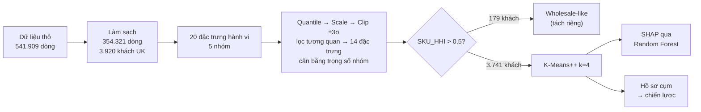
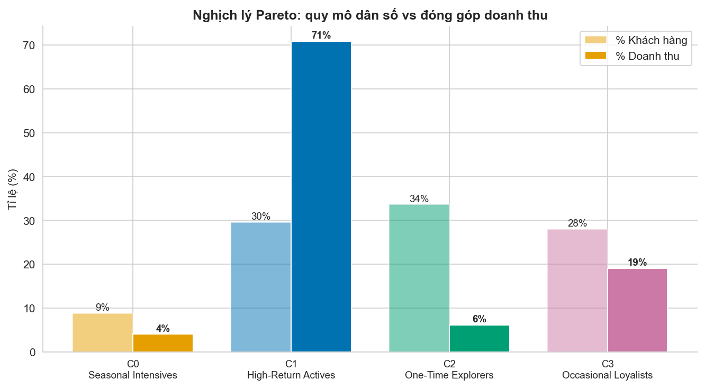
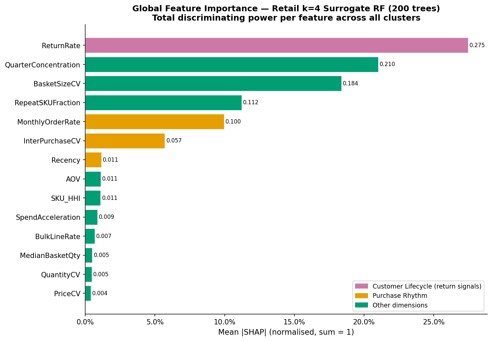

# Customer Segmentation — Behavioural Features · K-Means++ · SHAP

[](https://www.python.org/)
[](https://scikit-learn.org/)
[](https://github.com/shap/shap)
[](https://archive.ics.uci.edu/dataset/352/online+retail)
[](LICENSE)

Phân khúc khách hàng của một nhà bán lẻ quà tặng online ở UK dựa trên **hành vi mua sắm thực tế**, không chỉ dựa trên RFM. Dự án xây 20 đặc trưng hành vi, phân cụm hai giai đoạn (quy tắc + K-Means++), giải thích cụm bằng **SHAP** và biến mỗi cụm thành một chiến lược marketing cụ thể.

---

## Bài toán

Gửi cùng một thông điệp cho mọi khách hàng thì sẽ "đúng với vài người, lãng phí với phần còn lại". RFM (Recency, Frequency, Monetary) là cách phân khúc phổ biến, nhưng chỉ nhìn thấy 3 con số tổng nên bỏ sót nhiều hành vi:

- khách **huỷ hoặc trả đơn nhiều** nhưng vẫn mua thường xuyên;
- khách **mua theo mùa** bị xếp nhầm vào nhóm "sắp rời bỏ";
- khách **mua sỉ** lẫn với khách lẻ;
- **nhịp mua** (đều hay dồn dập) và **độ đa dạng giỏ hàng** không được đo.

Dự án trả lời: *khách hàng có những nhóm hành vi nào, vì sao một khách thuộc nhóm đó, và nên làm gì với từng nhóm?*

## Pipeline



| Nhóm đặc trưng | Câu hỏi | Ví dụ |
|----------------|---------|-------|
| Purchase Rhythm | Mua theo nhịp nào? | `Recency`, `InterPurchaseCV`, `MonthlyOrderRate` |
| Spending Shape | Chi tiêu ra sao? | `AOV`, `PriceCV`, `SpendAcceleration` |
| Basket Behaviour | Mỗi lần mua gì? | `RepeatSKUFraction`, `BasketSizeCV` |
| Volume & Bulk | Có phải khách sỉ? | `SKU_HHI`, `BulkLineRate`, `MedianBasketQty` |
| Customer Lifecycle | RFM không thấy gì? | `ReturnRate`, `QuarterConcentration` |

## Kết quả

| Cụm | Tên | Khách | % doanh thu* | Đặc điểm (trung vị) | Chiến lược |
|-----|-----|------:|:------------:|---------------------|------------|
| C0 | Seasonal Intensives | 330 (8,8%) | 4,0% | 2 đơn dồn trong một quý | Đón đầu mùa, tạo đơn ngoài mùa |
| C1 | High-Return Actives | 1.107 (29,6%) | **70,9%** | 6 đơn, huỷ 25% hoá đơn, LTV £1.972 | Giữ chân VIP, giảm tỉ lệ huỷ |
| C2 | One-Time Explorers | 1.257 (33,6%) | 6,1% | 1 đơn, 125 ngày chưa quay lại | Kích hoạt đơn thứ 2 qua kênh rẻ |
| C3 | Occasional Loyalists | 1.047 (28,0%) | 19,0% | 3 đơn, không huỷ, mua đều các quý | Tăng tần suất, nâng hạng lên C1 |

\* Doanh thu gộp (chưa trừ đơn huỷ).

- **Phân cụm:** Silhouette 0,244 · Davies-Bouldin 1,764 · Calinski-Harabasz 1.066 (k=4).
- **Giải thích:** Random Forest bắt chước nhãn K-Means với độ chính xác **99,0%** (5-fold CV). Đặc trưng quan trọng nhất: `ReturnRate` (27%), `QuarterConcentration` (21%), `BasketSizeCV` (18%).

<p align="center">
  
  
</p>

## Cấu trúc thư mục

```
├── notebooks/
│   ├── 01_cleaning_and_eda.ipynb      # làm sạch, EDA, RFM baseline
│   ├── 02_feature_engineering.ipynb   # 20 đặc trưng → 14, tách nhóm wholesale-like
│   ├── 03_modeling.ipynb              # chọn k, K-Means++, đặt tên cụm
│   ├── 04_shap_analysis.ipynb         # surrogate Random Forest + SHAP
│   └── 05_cluster_profiling.ipynb     # hồ sơ cụm bằng £ / đơn / ngày, chiến lược
├── src/
│   ├── clustering_library/            # toàn bộ logic: làm sạch, đặc trưng, phân cụm, hồ sơ
│   ├── notebook_io.py                 # quản lý đường dẫn đọc/ghi
│   └── visual_style.py                # bảng màu thân thiện với người mù màu
├── tests/                             # pytest, chạy trên dữ liệu giả
├── figures/                           # hình xuất từ notebook
├── data/                              # (không commit) raw/, processed/, models/
├── pyproject.toml · uv.lock · requirements.txt
└── LICENSE
```

## Cách chạy

### 1. Cài môi trường

Cần **Python ≥ 3.10**. Khuyến nghị dùng [uv](https://docs.astral.sh/uv/):

```bash
git clone <url-repo-của-bạn>
cd <tên-thư-mục>
uv sync --dev
```

Hoặc dùng pip:

```bash
python -m venv .venv
source .venv/bin/activate        # Windows: .venv\Scripts\activate
pip install -r requirements.txt
pip install pytest jupyter ipykernel
```

### 2. Tải dữ liệu

Dataset không có sẵn trong repo.

1. Tải **Online Retail** tại <https://archive.ics.uci.edu/dataset/352/online+retail>, rồi giải nén để có `Online Retail.xlsx`.
2. Chuyển sang CSV và đặt tại `data/raw/online_retail.csv`:

```bash
uv run --with openpyxl python -c "import pandas as pd, pathlib; pathlib.Path('data/raw').mkdir(parents=True, exist_ok=True); pd.read_excel('Online Retail.xlsx').to_csv('data/raw/online_retail.csv', index=False, encoding='ISO-8859-1', errors='replace')"
```

Nếu dùng pip, cài `openpyxl` trước rồi chạy đoạn Python trên bằng `python -c`.

### 3. Chạy notebooks

Chạy **theo thứ tự 01 → 05**, vì mỗi notebook dùng kết quả của notebook trước:

```bash
uv run jupyter lab
```

Hoặc chạy cả 5 notebook từ dòng lệnh:

```bash
for nb in notebooks/0*.ipynb; do uv run jupyter nbconvert --to notebook --execute --inplace "$nb"; done
```

| Notebook | Tạo ra |
|----------|--------|
| 01 | `processed/cleaned_uk_data.csv` |
| 02 | `processed/customer_features_*_scaled.csv`, `b2b_customer_ids.csv`, `models/` |
| 03 | `processed/cluster_assignments_*.csv` |
| 04 | `figures/04_shap/*.png` |
| 05 | `processed/cluster_customer_profiles.csv`, `cluster_strategy_summary.csv` |

Mặc định kết quả được ghi vào `data/_sandbox/` để không đè lên bản chính thức. Đặt `SEG_CANONICAL_WRITE=1` nếu muốn ghi thẳng vào `data/`.

### 4. Chạy tests

```bash
uv run pytest
```

36 test chạy trên dữ liệu giả, không cần tải dataset.

### 5. Dùng thư viện trong code

```python
import sys; sys.path.insert(0, "src")
from clustering_library import DataCleaner, FeatureEngineer, CLUSTER_NAMES
from clustering_library.segmentation import split_b2b, fit_kmeans, canonical_labels

cleaner = DataCleaner("data/raw/online_retail.csv")
cleaner.load_data(); cleaner.clean_data(); cleaner.save_cleaned_data("data/processed")

fe = FeatureEngineer("data/processed/cleaned_uk_data.csv", raw_data_path="data/raw/online_retail.csv")
fe.load_data()
raw = fe.create_customer_features().set_index("CustomerID")
fe.transform_features()
X = fe.scale_features()

_, retail_ids = split_b2b(raw)
X_retail = X.loc[retail_ids]
labels = canonical_labels(X_retail, fit_kmeans(X_retail.values, k=4).labels_)
```

## Lưu ý

- **Doanh thu là doanh thu gộp.** Bước làm sạch bỏ hoá đơn huỷ nhưng giữ hoá đơn gốc, nên LTV của nhóm huỷ nhiều (C1) cao hơn doanh thu thực nhận.
- **Tên cụm là diễn giải** dựa trên trung vị đặc trưng. Silhouette ≈ 0,24 cho thấy các cụm có chồng lấn, nên kiểm tra độ ổn định và chạy A/B test trước khi dùng trong thực tế.
- Trước khi commit, nên xoá output notebook (*Clear All Outputs*, hoặc dùng [`nbstripout`](https://github.com/kynan/nbstripout)) để không đẩy đường dẫn máy cá nhân lên GitHub.

## Tech stack

`pandas` · `numpy` · `scikit-learn` · `shap` · `matplotlib` · `seaborn` · `scipy` · `joblib` · `pytest` · `uv`

## Nguồn và giấy phép

- Dữ liệu: Chen, D. (2015). *Online Retail* [Dataset]. UCI Machine Learning Repository. <https://doi.org/10.24432/C5BW33>
- Dự án phát triển từ tài liệu bài giảng **AI Vietnam** về phân khúc khách hàng.
- Phát hành theo giấy phép [MIT](LICENSE).
